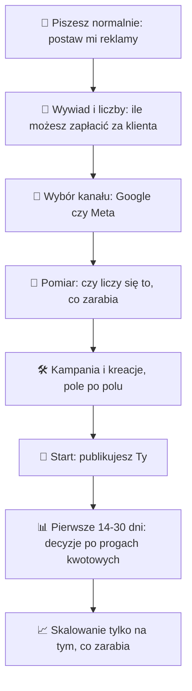
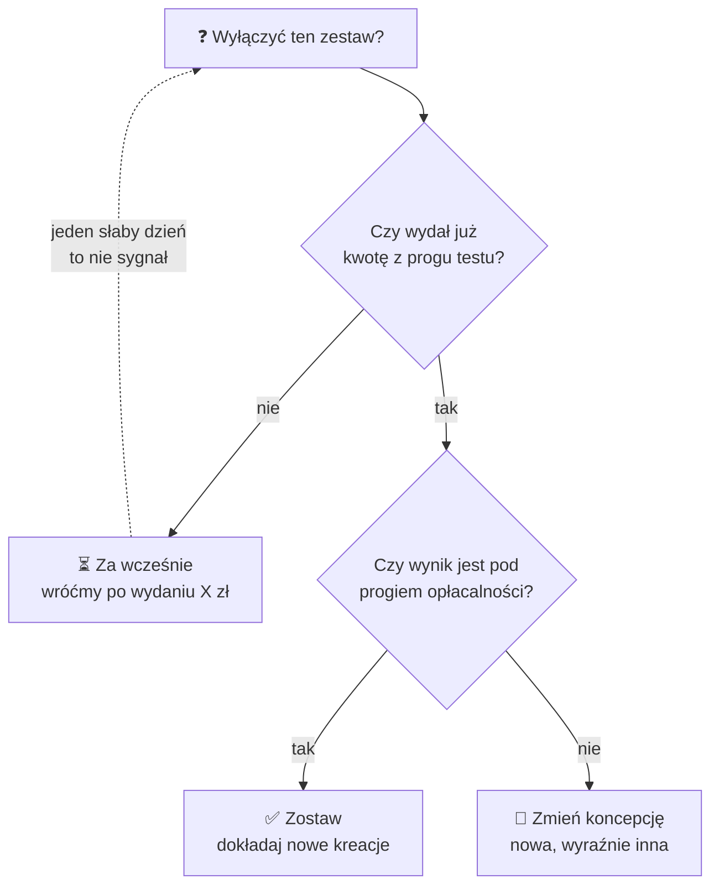
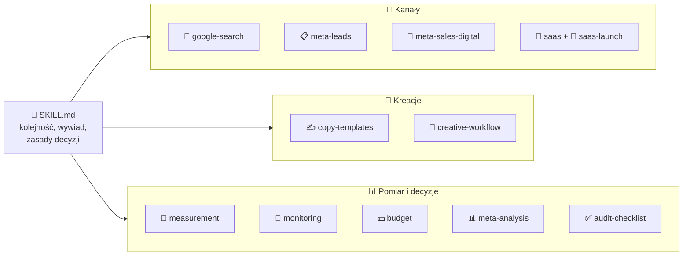

<p align="center">
  
</p>

<h1 align="center">ads-playbook</h1>

<p align="center"><b>Instrukcja obsługi reklam dla Claude'a.</b><br>Google Search i Meta: postawienie kampanii, audyt, kreacje i decyzje bez zgadywania.</p>

<p align="center">
  
  
  
  
  
</p>

---

## 🧠 W skrócie

Instalujesz raz. Od tej pory, gdy napiszesz do Claude'a „postaw mi reklamy na Facebooku”, **on nie zgaduje**:

- **liczy**, ile możesz zapłacić za klienta, żeby reklamy się zwracały,
- **ustawia** kampanię krok po kroku, pole po polu,
- **pisze** teksty i pomysły na kreacje,
- **mówi**, kiedy coś wyłączyć, a kiedy dać temu spokój, zawsze z liczbą i regułą.

| Obsługuje | Kiedy |
|---|---|
| **Google Ads (wyszukiwarka)** | ludzie już szukają tego, co sprzedajesz |
| **Meta na leady** | sprzedaż domyka rozmowa z klientem (B2B, usługi lokalne) |
| **Meta na sprzedaż** | ebooki, kursy, szablony i inne produkty cyfrowe |
| **SaaS i aplikacje w abonamencie** | z rachunkiem, ile możesz wydać, żeby wyjść na zero |

## 👥 Dla kogo

- Właściciel SaaS-a, aplikacji albo produktu cyfrowego, który chce puścić reklamy i nie wie, od czego zacząć.
- Ktoś, kto już puszcza reklamy i nie rozumie, czemu przestały działać.
- Ktoś, kto prowadzi reklamy klientom i chce mieć powtarzalny proces.

> Nie musisz znać się na reklamach. Skill każe Claude'owi tłumaczyć każdą liczbę i każdą decyzję.

## ⚙️ Jak to działa



### 🚦 Jak Claude decyduje „wyłączyć czy nie”

Najczęstszy błąd w reklamach to wyłączanie i włączanie wszystkiego co dzień. Skill tego zabrania:



## 🚀 Jak zacząć (3 kroki)

**Zainstaluj skill w Claude Code.**

Mac / Linux:
```bash
git clone https://github.com/egzey0/ads-playbook ~/.claude/skills/ads-playbook
```

Windows (PowerShell):
```powershell
git clone https://github.com/egzey0/ads-playbook "$HOME/.claude/skills/ads-playbook"
```

Używasz Claude.ai zamiast Claude Code? Utwórz projekt i wgraj do jego wiedzy `SKILL.md` oraz wszystkie pliki z folderu `references/`.

**(Opcjonalnie) podłącz konto reklamowe.** Z podłączonym Meta Ads (connector MCP) Claude sam czyta wyniki i przegląda Bibliotekę reklam. Bez tego też działa: wklejasz zrzuty ekranu albo eksport z Menedżera reklam.

**Napisz do Claude'a normalnym językiem.** Skill włącza się sam.

## 💬 Co możesz napisać

| Chcesz | Napisz na przykład |
|---|---|
| Postawić pierwszą kampanię | „Mam SaaS do fakturowania za 49 zł miesięcznie, postaw mi reklamy na Facebooku” |
| Zrozumieć, ile możesz wydać | „Ile mogę zapłacić za klienta, żeby reklamy mi się zwracały?” |
| Sprawdzić, czy budżet ma sens | „Mam 50 zł na reklamy ebooka, wystarczy?” |
| Sprawdzić, czemu nie działa | „Reklamy zjadają kasę, a nikt nie kupuje, zobacz co jest nie tak” |
| Zdecydować o wyłączeniu | „Ten zestaw od 2 dni nic nie sprzedaje, wyłączyć?” |
| Ogarnąć kreacje bez budżetu | „Mam 6 reklam w zestawie, wydają tylko 2, co z resztą?” |
| Zwiększyć budżet | „Kampania zarabia, mogę dać więcej?” |
| Kreacje | „Pomóż mi wymyślić reklamy, zobacz co puszcza konkurencja” |
| Przegląd konta | „Zrób audyt mojego konta Meta” |

## 🔮 Czego się spodziewać

| | |
|---|---|
| **Najpierw pytania, potem kampania** | Krótka pierwsza odpowiedź: wstępny rachunek na założeniach i maksymalnie 3 pytania, każde z wyjaśnieniem, po co. Pełne ustawienia po Twoich odpowiedziach |
| **Bez paniki po jednym dniu** | Decyzje dopiero po wydaniu konkretnej kwoty, zawsze z regułą i liczbami. Za mało danych? Usłyszysz „za wcześnie” i kiedy wrócić |
| **Pierwsze dni bywają słabe** | Nowe konto potrafi kilka dni prawie nic nie wydawać, a pierwsza kreacja rzadko wygrywa. To normalne |
| **Uczciwie o ryzyku** | Część budżetu testowego idzie na naukę. Usłyszysz z góry ile i czego reklamy nie naprawią (słaba strona, onboarding, oferta) |
| **Uczciwie o budżecie** | Ocena 🟢 wystarczy / 🟡 na styk / 🔴 za mało. Przy za małym budżecie usłyszysz, co zrobić zamiast reklam (organika, pierwsze sprzedaże ręcznie, poprawa strony), a nie kampanię, która niczego nie powie |
| **Nic bez Twojej zgody** | Domyślnie tylko czyta. Zmiany pokazuje jako „przed i po”. Kampanie publikujesz Ty |
| **Wie, czego jest pewien** | Każda reguła ma poziom pewności: sprawdzone wielokrotnie, sprawdzone raz, standard albo hipoteza. Hipotez nie sprzedaje jako faktów |

## 📖 Słowniczek

| Pojęcie | Po ludzku |
|---|---|
| Break even / „na zero” | Moment, w którym reklama zwróciła tyle, ile kosztowała. Wszystko powyżej to zysk |
| CAC | Ile kosztuje Cię pozyskanie jednego płacącego klienta z reklam |
| LTV | Ile zarobisz na kliencie przez cały czas, kiedy u Ciebie płaci |
| Churn | Jaki procent płacących klientów rezygnuje w miesiącu |
| ⏳ Zwrot (payback) | Po ilu miesiącach płacenia klient „oddał” koszt reklamy |
| Trial | Darmowy okres próbny przed pierwszą płatnością |
| ROAS | Ile złotych przychodu przyniosła każda złotówka wydana na reklamy |
| Zestaw reklam (adset) | Część kampanii, w której ustawiasz, komu i za ile pokazujesz reklamy |
| Kreacja | Grafika albo film w reklamie |
| Pixel | Kod na stronie, który mówi Facebookowi, kto kupił, żeby ten szukał podobnych ludzi |

## ❓ FAQ

<details>
<summary><b>Czemu Claude nie każe wyłączyć reklamy, która od wczoraj nic nie sprzedała?</b></summary>

Bo jeden dzień to za mało danych. Reklamy mają naturalne wahania, a ciągłe wyłączanie i włączanie psuje naukę algorytmu. Decyzja zapada po wydaniu kwoty, którą Claude poda z góry.
</details>

<details>
<summary><b>Mój SaaS ma reklamy „na zero”. To źle?</b></summary>

Nie musi. Pytanie brzmi: na zero w jakim czasie. Na zero po pierwszej płatności to zwykle za surowo, a na zero po kilku miesiącach płacenia to często rozsądny plan. Claude policzy oba warianty, uwzględni to, że część klientów odchodzi, i zapyta, który wybierasz.
</details>

<details>
<summary><b>Mam tylko 50 zł. Puścić reklamy?</b></summary>

Zależy, czy dziennie, czy w sumie. 50 zł dziennie to około 1500 zł miesięcznie i na test wystarczy. 50 zł w sumie to za mało, żeby reklama czegokolwiek się nauczyła. Wtedy Claude odradzi kampanię i zaproponuje coś, co da więcej: organiczne rolki, pierwsze sprzedaże ręcznie albo poprawę strony, zanim zaczniesz płacić za ruch.
</details>

<details>
<summary><b>Mam 6 kreacji w zestawie, a wydają tylko 2. Co z resztą?</b></summary>

Nic, jeśli te 2 trzymają wynik. Meta wybiera reklamy, w które wierzy, a pozostałe nie są złe, tylko jeszcze niesprawdzone. Nie wyłączaj zwycięzcy, żeby zmusić Metę do wydawania na resztę, i nie przenoś ich na siłę do innego zestawu. Chcesz sprawdzić konkretną kreację? Claude ustawi test kreacji z równym budżetem albo mały osobny zestaw testowy.
</details>

<details>
<summary><b>Czy Claude sam zrobi grafiki?</b></summary>

Pomoże je wymyślić: sprawdzi reklamy konkurencji w Bibliotece reklam Meta, zaproponuje koncepcje, które się sprawdzają, i napisze teksty. Grafiki zrobi, jeśli ma podłączony generator obrazów. Jeśli nie, dostaniesz brief do Canvy albo dla grafika.
</details>

<details>
<summary><b>Czy muszę coś podłączać?</b></summary>

Nie. Z podłączonym kontem jest wygodniej, bo Claude sam czyta wyniki. Bez tego wklejasz mu zrzuty ekranu.
</details>

<details>
<summary><b>Mam aplikację mobilną z płatnością w App Store. Zadziała?</b></summary>

Częściowo. Rachunek opłacalności tak, ale kampanie na instalacje wymagają osobnego pomiaru. Claude powie to wprost i nie będzie zgadywał ustawień.
</details>

## 🗂️ Co jest w środku

| Plik | Do czego |
|---|---|
| `SKILL.md` | kolejność pracy, wywiad, tryby (postaw / audyt / doradztwo / kreacje), zasady decyzji, bezpieczeństwo |
| `references/google-search.md` | ustawienia, struktura kampanii, wariant lokalny, szablon RSA |
| `references/meta-leads.md` | leady z formularza, B2B i usługi lokalne, ile żyje kreacja |
| `references/meta-sales-digital.md` | kampania Sprzedaż pod produkt cyfrowy krok po kroku |
| `references/saas.md` | próg opłacalności, zwrot z churnem, pomiar płacących, model oferty, kalkulator |
| `references/saas-launch.md` | wypuszczenie kampanii SaaS: bramka, Google, Meta, progi na 30 dni, skalowanie |
| `references/meta-analysis.md` | kolumny, podziały, diagnoza lejka, jak wyceniać problemy |
| `references/retargeting.md` | kiedy retargeting ma sens, wielkość grupy, grupy i wykluczenia, Meta i Google, ocena |
| `references/copy-templates.md` | cechy tekstów, które działają, szablony do wypełnienia |
| `references/creative-workflow.md` | research w Bibliotece reklam, koncepcje, briefy kreacji |
| `references/measurement.md` | co jest konwersją (leady, sprzedaż, subskrypcja), raport tygodniowy |
| `references/monitoring.md` | progi wyłączania, nowe konto, zmęczenie kreacji, skalowanie |
| `references/budget.md` | czy budżet ma sens (🟢/🟡/🔴), gotowe układy na 500 / 1000 / 5000 zł miesięcznie, co zamiast reklam |
| `references/audit-checklist.md` | przegląd istniejącego konta |



<details>
<summary><b>Czym się różni od claude-ads</b></summary>

[claude-ads](https://github.com/AgriciDaniel/claude-ads) to szeroki system audytowy: 12 platform, ponad 400 kontrolek audytowych, punktacja, wersjonowane JSON-y, subagenci, bramka zmian na koncie. Celowo **nie ma w nim konkretnych reguł**: każda kontrolka mówi „oceń na podstawie bieżących dowodów”, benchmarki są zakazane jako progi, a frameworki copy są „pytaniami”, nie szablonami.

| | claude-ads | ads-playbook |
|---|---|---|
| Zakres | 12 platform | Google Search, Meta lead, Meta sprzedaż i SaaS, to, co robimy |
| Główne zadanie | audyt i scoring | postawienie kampanii, copy, prowadzenie |
| Reguły | neutralne, „zależy od danych” | konkretne decyzje z praktyki, z poziomem pewności |
| Copy | AIDA, PAS jako pytania | gotowe szablony do wypełnienia |
| Benchmarki | zakazane jako progi | progi decyzyjne (kiedy wyłączyć, kiedy skalować) i rachunek break even |
| Rozmiar | duży (Python, schematy, CI) | 13 plików Markdown, zero kodu |
| Bezpieczeństwo zmian | formalna bramka, idempotencja, rollback | odczyt domyślnie, plan przed/po, zgoda, bez usuwania |

Co wzięliśmy z claude-ads: zasadę „tylko odczyt, dopóki właściciel nie zatwierdzi konkretnej zmiany”, rozdzielanie faktów od hipotez i zakaz wymyślania wykluczeń bez raportu wyszukiwanych haseł. Czego nie wzięliśmy: punktacji, orkiestracji subagentów, rejestru źródeł. Przy 1-3 kontach małych firm to narzut, który nie zmienia decyzji.
</details>

## 🔧 Aktualizacja

Każdy nowy wniosek wpisuj jako ogólną regułę z poziomem pewności, bez nazw klientów, branż, słów kluczowych i tekstów reklam. Hipoteza staje się „sprawdzone raz” po pierwszym potwierdzeniu w kampanii, a „sprawdzone” dopiero, gdy potwierdzi się w kolejnej.
